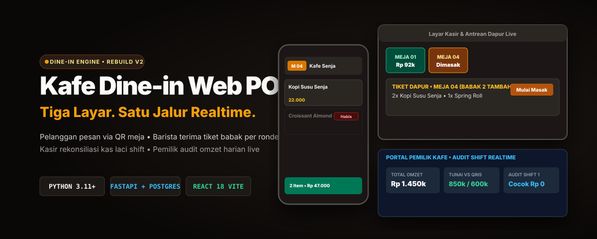

<p align="center">
  
</p>

# Kafe Dine-in Web POS

Aplikasi Point of Sale (POS) dine-in multi-tenant berbasis web yang dirancang untuk operasional kafe mandiri skala 10-25 meja. Seluruh sistem berjalan langsung di browser modern tanpa instalasi aplikasi native, tanpa biaya langganan bulanan (arsitektur hosting Rp 0), dan mendukung pencetakan struk printer thermal 58mm.

---

## Tiga Portal Utama

1. **Pelanggan Meja (`/t/:tableId`):**
   - Masuk melalui pemindaian stiker QR meja resmi tanpa registrasi akun.
   - Katalog menu visual dengan label status habis jika stok kosong.
   - Pemesanan bertingkat (multi-round) untuk pesanan tambahan di babak baru.
   - Pemantauan status dapur secara langsung lewat Server-Sent Events (SSE).
   - Penyesuaian otomatis jika kasir memindahkan meja atau membatalkan pesanan.

2. **Kasir dan Dapur (`/cashier`):**
   - Denah meja visual (meja kosong, terisi, dan durasi kunjungan).
   - Antrean dapur berbasis live stream yang memisahkan tiket per babak (Babak 1, Babak 2 Tambahan) dengan status mandiri (Baru Masuk, Sedang Dimasak, Tersaji).
   - Pengelolaan uang kas laci: pencatatan modal awal shift dan monitoring omzet tunai vs QRIS secara terpisah.
   - Rekonsiliasi kas saat tutup shift: mencocokkan uang fisik laci dengan pencatatan sistem (status cocok, lebih, atau minus).
   - Pelunasan transaksi tunai dan QRIS statis dengan proteksi double-pay via header `Idempotency-Key`.
   - Cetak struk thermal 58mm langsung lewat dialog cetak browser (`window.print()`).

3. **Pemilik Kafe / Admin (`/admin`):**
   - Empat kartu indikator keuangan: total omzet, penerimaan tunai, penerimaan QRIS, dan peringatan stok bahan baku menipis.
   - Grafik tren penjualan 7 hari terakhir berdampingan dengan ranking menu terlaris.
   - Rekapitulasi penjualan bulanan (12 bulan terakhir).
   - Audit riwayat shift kasir secara realtime: memeriksa modal awal, total penjualan, uang fisik, dan selisih kas per shift.
   - Kendali ketersediaan menu dan saklar instan menu habis.
   - Ekspor laporan pembukuan ke file CSV streaming.
   - Generator lembar cetak stiker QR meja ukuran A4 siap gunting.

---

## Arsitektur Sistem

```
[Pelanggan HP]              [Kasir & Dapur Tablet/PC]             [Pemilik Laptop/PC]
  (/t/:tableId)                    (/cashier)                           (/admin)
       │                               │                                   │
       ├───────────────────────────────┴───────────────────────────────────┤
       │ REST Requests (JSON) / Realtime SSE Stream                        │
       ▼                                                                   ▼
┌──────────────────────────────────────────────────────────────────────────────────┐
│ FASTAPI BACKEND (Python 3.11+)                                                   │
│                                                                                  │
│ • Routers API v1 (/auth, /menu, /orders, /shifts, /reports, /tables)             │
│ • Sesi Meja: HMAC-SHA256 Signed Token                                            │
│ • Autentikasi Staf: Argon2id Password Hashing & JWT Bearer Token                 │
│ • Mesin Stok Atomik: Conditional Atomic Update (UPDATE ... WHERE stock >= qty)   │
│ • In-Memory SSE Broadcaster: Fan-out event realtime per tenant                   │
└────────────────────────────────────────┬─────────────────────────────────────────┘
                                         │ SQLAlchemy 2.0 Async ORM (asyncpg)
                                         ▼
┌──────────────────────────────────────────────────────────────────────────────────┐
│ POSTGRESQL 15+ (Multi-Tenant Row-Level via tenant_id)                           │
│                                                                                  │
│ • tenants, users, tables, categories, products                                  │
│ • orders, order_items (round_number, item_status)                                │
│ • payments (CASH, STATIC_QRIS, Idempotency-Key unik)                             │
│ • cashier_shifts (starting_cash, expected_cash, actual_cash, cash_difference)    │
└──────────────────────────────────────────────────────────────────────────────────┘
```

Diagram visual interaktif yang telah divalidasi kualitas showcase dapat dibuka di:  
`.archify/architecture-phase5-ops-deployment-20261108-164500/architecture-phase5.html`

---

## Dokumentasi API (Swagger & ReDoc)

FastAPI secara otomatis menyediakan dokumentasi interaktif OpenAPI:
- **Swagger UI:** `http://localhost:8000/docs`
- **ReDoc UI:** `http://localhost:8000/redoc`
- **OpenAPI Schema JSON:** `http://localhost:8000/openapi.json`

Setiap endpoint dikelompokkan dalam 11 kategori tag:
1. `Customer Menu`: Katalog publik pelanggan meja.
2. `Orders`: Siklus hidup bon, pemesanan multi-round, dan pembatalan pesanan.
3. `Payments`: Pelunasan tagihan kasir berproteksi idempotensi.
4. `Cashier Shifts`: Manajemen kas laci, live omzet, dan audit shift.
5. `Realtime SSE`: Jalur streaming Server-Sent Events.
6. `Reports & Analytics`: Metrik omzet, rekapitulasi, dan ekspor CSV.
7. `Tables`: Denah meja dan generator QR token.
8. `Products`: Manajemen menu dan stok bahan baku.
9. `Categories`: Pengelompokan jenis makanan, minuman, dan snack.
10. `Authentication`: Login staf kasir dan pemilik.
11. `Health`: Pemeriksaan kesiapan server.

---

## Cara Menjalankan di Komputer Lokal

### Prasyarat
- Python 3.10 atau lebih baru
- Node.js 18 atau lebih baru
- Docker Desktop (untuk PostgreSQL lokal)

### 1. Menjalankan Database
```bash
docker compose up -d
```
Database PostgreSQL akan berjalan pada port `5432` dengan user `postgres` dan database `posapp`.

### 2. Menjalankan Backend
```bash
cd backend

# Buat virtual environment jika belum ada
python -m venv .venv
source .venv/bin/activate  # Di Windows: .venv\Scripts\activate

# Instal dependensi
pip install -r requirements.txt

# Jalankan migrasi database
alembic upgrade head

# Isi data awal kafe contoh
python -m scripts.seed_data

# Jalankan server development
uvicorn app.main:app --host 0.0.0.0 --port 8000 --reload
```

Kredensial staf bawaan setelah seeding:
- **Admin/Owner:** `admin_senja` / `AdminPass123!`
- **Kasir:** `kasir_bima` / `KasirPass123!`

### 3. Menjalankan Frontend
```bash
cd frontend

# Instal dependensi
npm install

# Jalankan Vite development server
npm run dev
```

Akses portal melalui browser:
- Portal Kasir: `http://localhost:5173/cashier`
- Portal Admin: `http://localhost:5173/admin`
- Pemesanan Meja Pelanggan: Melalui link QR yang dihasilkan di portal Admin.

---

## Pengujian Otomatis

Seluruh logika kritis diuji menggunakan Pytest (backend) dan pemeriksaan kompilasi TypeScript (frontend):

```bash
# Menjalankan 24 test suite transaksi, keamanan, dan laporan backend
cd backend
pytest -v

# Memeriksa tipe dan build produksi frontend
cd frontend
npm run build
```

---

## Panduan Deployment Cloud Gratis (Rp 0)

Langkah detail deployment produksi tiga pilar (Database Neon/Supabase + Backend Render + Frontend Vercel) tersedia di dokumen:  
`docs/deployment-guide.md`
