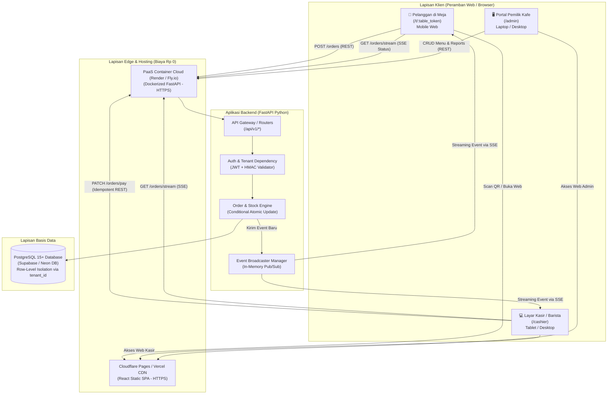
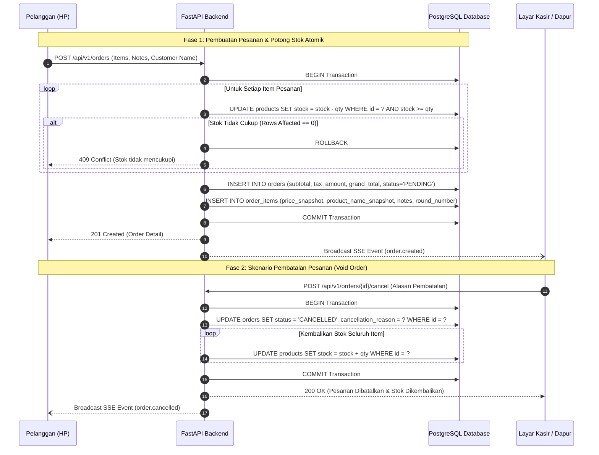

# Technical Requirement Documentation (TRD)

Dokumen ini mendefinisikan arsitektur teknis, spesifikasi komponen, protokol komunikasi, strategi integritas data, mekanisme keamanan, serta infrastruktur *deployment* untuk pembangunan ulang Kafe Dine-in Web POS. Dokumen ini merupakan turunan langsung dari `docs/01-PRD.md` dan memetakan pemenuhan seluruh kebutuhan fungsional (FR-01 s.d. FR-28) dan non-fungsional (NFR-01 s.d. NFR-08).

---

## 1. Pendahuluan & Sasaran Teknis

### 1.1 Tujuan Dokumen
TRD ini menjadi cetak biru rekayasa (*engineering blueprint*) bagi pengembang dan agen AI dalam mengimplementasikan sistem. Setiap keputusan teknis yang diambil didasarkan pada prinsip keandalan finansial, kesederhanaan operasional bagi pengembang tunggal, serta efisiensi biaya infrastruktur (target biaya operasional Rp 0 pada fase validasi).

### 1.2 Sasaran Teknis Utama
1. **Integritas Transaksi Finansial & Stok:** Mencegah terjadinya penjualan melebihi stok (*overselling*) dan transaksi ganda melalui transaksi ACID dan kueri atomik berkondisi.
2. **Isolasi Data Multi-Tenant yang Aman:** Mencegah kebocoran data antar kafe melalui *Row-Level Isolation* yang ditegakkan di lapisan backend (*Application-Level Enforcement* via *Dependency Injection*).
3. **Komunikasi Realtime yang Tangguh & Efisien:** Menggunakan *Server-Sent Events* (SSE) satu arah dengan mekanisme *auto-reconnect* untuk menyalurkan pembaruan pesanan ke kasir dan pelanggan tanpa *overhead* protokol socket dua arah yang berlebihan.
4. **Portabilitas & Zero Hardware Lock-in:** Seluruh antarmuka berjalan pada peramban web modern (HTML5, CSS3, JavaScript/TypeScript) yang dapat diakses dari peranti apa pun tanpa kompilasi native khusus.

---

## 2. Pemilihan Stack Teknologi & Justifikasi

### 2.1 Ringkasan Teknologi Terpilih

| Lapisan Sistem | Teknologi | Versi Minimum | Peran & Tanggung Jawab |
| :--- | :--- | :--- | :--- |
| **Backend Runtime** | Python | 3.11+ | Lingkungan eksekusi backend asynchronous. |
| **Web Framework** | FastAPI | 0.110+ | Framework REST API berbasis ASGI, routing, Dependency Injection, dan OpenAPI. |
| **Validasi & DTO** | Pydantic | v2.6+ | Validasi tipe data request/response, serialisasi JSON cepat, settings management. |
| **Database ORM** | SQLAlchemy (Async) | 2.0+ | Pemetaan objek relasional asynchronous dan query builder. |
| **Migrasi Database** | Alembic | 1.13+ | Manajemen versi skema dan migrasi database terstruktur. |
| **Database Engine** | PostgreSQL | 15+ | Database relasional ACID, indeks performa tinggi, dan dukungan JSONB. |
| **Frontend Web** | React (Vite) | 18+ | Single Page Application (SPA) antarmuka Customer, Kasir, dan Admin. |
| **Bahasa Frontend** | TypeScript | 5.0+ | Type safety antarmuka frontend yang selaras dengan skema Pydantic backend. |
| **Styling** | Tailwind CSS | 3.4+ | Framework utilitas CSS untuk tata letak responsif dan aksesibel. |
| **Testing** | Pytest + HTTPX | 8.0+ | Pengujian otomatis integrasi transaksi, anomali, dan keamanan backend. |
| **Kontainerisasi** | Docker & Compose | 24+ | Standarisasi lingkungan pengujian lokal dan pengemasan produksi. |

---

### 2.2 Justifikasi Pemilihan Stack (Trade-Off Analysis)

#### 1. Backend: Mengapa Python (FastAPI) vs Node.js vs Django?
* **Pilihan: FastAPI (Python 3.11+).**
  * *Alasan:* Pemilik proyek (Bima) telah memiliki dasar kemampuan Python yang kuat. FastAPI menghilangkan kebutuhan belajar bahasa baru, sehingga fokus belajar dapat dicurahkan 100% pada konsep backend: arsitektur REST, *dependency injection*, transaksi ACID, *async concurrency*, dan keamanan.
  * *Trade-off:* Node.js (TypeScript) memang memiliki keuntungan keseragaman satu bahasa dengan frontend. Namun, kurva belajar TypeScript backend dan pengelolaan *event loop* Node.js untuk pemula menambah risiko keterlambatan proyek. Sementara itu, Django terlalu berat (*monolithic battery-included*) dan fitur ORM bawaannya kurang fleksibel untuk kontrol transaksi atomik granular dibandingkan SQLAlchemy 2.0.
  * *Kelebihan FastAPI:* Kecepatan eksekusi tinggi setara NodeJS berkat *Starlette* dan *Uvicorn*, validasi data otomatis menggunakan Pydantic v2 yang ditulis dalam Rust, serta dokumentasi interaktif otomatis Swagger UI (`/docs`).

#### 2. Database: Mengapa PostgreSQL vs MySQL vs MongoDB?
* **Pilihan: PostgreSQL.**
  * *Kritisi Desain Lama (MySQL):* MySQL bawaan XAMPP pada proyek lama tidak mendukung *Row-Level Security* native, memiliki perilaku penanganan tipe data enum yang kaku, dan dukungan JSON yang terbatas.
  * *Alasan PostgreSQL:* PostgreSQL adalah standar emas industri untuk sistem keuangan. Menawarkan tingkat kepatuhan ACID tertinggi, isolasi transaksi yang ketat, serta fleksibilitas kolom JSONB jika di masa depan dibutuhkan metadata tambahan.
  * *Faktor Infrastruktur Cloud Rp 0:* Penyedia database terkelola gratis terbaik saat ini (Supabase dan Neon) berbasis PostgreSQL dengan fitur *connection pooling* bawaan (*PgBouncer*).

#### 3. Protokol Komunikasi: Mengapa Hybrid REST + SSE vs Raw WebSocket?
* **Pilihan: REST API untuk Mutasi Data + Server-Sent Events (SSE) untuk Notifikasi Live.**
  * *Kritisi Desain Lama (Raw WebSocket di index.js):* Menggunakan WebSocket mentah untuk seluruh operasi (seperti `cart_update` di kode lama) adalah antipattern. WebSocket tidak memiliki kode status HTTP standar (200, 400, 401, 409), tidak memiliki validasi skema otomatis, tidak ramah proxy HTTP, dan sulit di-debug via *Network tab* peramban. Jika server restart, koneksi putus tanpa penanganan *reconnect* standar.
  * *Keunggulan REST + SSE:*
    1. **Mutasi Data via REST:** Setiap aksi pesanan (`POST /orders`) atau pembayaran (`PATCH /orders/{id}/pay`) memiliki endpoint terpisah dengan validasi Pydantic ketat dan status code HTTP standar industri.
    2. **Notifikasi via SSE (`GET /api/v1/orders/stream`):** Aliran data satu arah (*server-to-client*) melalui protokol HTTP standar. Browser memiliki antarmuka JavaScript `EventSource` bawaan yang secara otomatis menangani penyambungan ulang (*auto-reconnect*) jika jaringan WiFi kafe terputus sesaat, tanpa membutuhkan pustaka pihak ketiga yang rumit.

```
+---------------------------------------------------------------------------------------+
| PERBANDINGAN PROTOKOL REALTIME                                                        |
+-------------------+--------------------+-----------------------+----------------------+
| Kriteria          | WebSocket Mentah   | Short Polling (HTTP)  | REST + SSE (Dipilih) |
+-------------------+--------------------+-----------------------+----------------------+
| Status Code HTTP  | Tidak ada (Custom) | Lengkap               | Lengkap              |
| Arah Komunikasi   | Dua arah (Duplex)  | Klien meminta         | Server mengirim      |
| Beban Server      | Sedang (Keepalive) | Berat (Request terus) | Sangat Ringan        |
| Auto-Reconnect    | Manual (Kodingan)  | Bawaan loop           | Otomatis via Browser |
| Debugging         | Sulit              | Mudah                 | Sangat Mudah         |
+-------------------+--------------------+-----------------------+----------------------+
```

#### 4. Frontend: Mengapa React (Vite) Single Page Application?
* **Pilihan: React 18+ dengan Vite + TypeScript + Tailwind CSS.**
  * *Alasan:* Menghasilkan berkas statis HTML, JS, dan CSS murni setelah proses build. Berkas statis ini dapat di-host secara **100% gratis** dengan kecepatan tinggi di CDN global (Vercel atau Cloudflare Pages).
  * *Menghindari Server-Side Rendering (Next.js):* Next.js membutuhkan server Node.js aktif yang memakan kuota memori pada layanan hosting gratis dan menambah kerumitan deployment yang tidak dibutuhkan, mengingat backend kita sudah terpusat di FastAPI.

---

## 3. Arsitektur Sistem & Data Flow

### 3.1 Diagram Arsitektur Tingkat Tinggi



---

### 3.2 Struktur Modular Backend (FastAPI Clean Architecture)

Backend disusun menggunakan pola modular berlapis untuk memisahkan tanggung jawab kode secara bersih:

```
backend/
├── app/
│   ├── api/
│   │   └── v1/
│   │       ├── endpoints/
│   │       │   ├── auth.py         # Login kasir/admin, token refresh
│   │       │   ├── categories.py   # CRUD Kategori menu
│   │       │   ├── products.py     # CRUD Produk, stok, saklar menu habis
│   │       │   ├── tables.py       # CRUD Meja & generate QR token
│   │       │   ├── orders.py       # Pembuatan order, void, move table, pelunasan
│   │       │   ├── shifts.py       # Buka shift, tutup shift, rekonsiliasi kas
│   │       │   └── reports.py      # Ringkasan omzet, ekspor CSV
│   │       └── router.py           # Agregator seluruh endpoint v1
│   ├── core/
│   │   ├── config.py               # Pydantic BaseSettings membaca berkas .env
│   │   ├── database.py             # SQLAlchemy Async Engine & Session Local
│   │   ├── security.py             # Hashing Argon2/Bcrypt & encoding/decoding JWT
│   │   └── exceptions.py           # Handler kustom exception dan format JSON error
│   ├── deps/
│   │   ├── auth.py                 # Dependency: get_current_user, require_admin, require_cashier
│   │   ├── tenant.py               # Dependency: enforce_tenant_id (ekstraksi tenant sah)
│   │   └── db.py                   # Dependency: get_async_db (injeksi sesi database)
│   ├── models/                     # Deklarasi tabel SQLAlchemy ORM
│   │   ├── tenant.py
│   │   ├── user.py
│   │   ├── table.py
│   │   ├── product.py
│   │   ├── order.py
│   │   └── shift.py
│   ├── schemas/                    # Deklarasi Pydantic DTO (Request & Response)
│   │   ├── auth.py
│   │   ├── product.py
│   │   ├── order.py
│   │   └── shift.py
│   └── services/                   # Logika bisnis transaksional
│       ├── order_service.py        # Mesin transaksi stok atomik & kalkulasi tagihan
│       ├── payment_service.py      # Penanganan idempotensi & pencatatan kas
│       └── sse_broadcaster.py      # Pengelola antrean event SSE memory/asyncio
├── alembic/                        # Skrip migrasi skema basis data
├── tests/                          # Automated test suite (Pytest)
├── Dockerfile                      # Multi-stage Docker build
└── docker-compose.yml              # Orkestrasi PostgreSQL & Backend lokal
```

---

## 4. Keamanan, Multi-Tenancy, & Autentikasi

### 4.1 Strategi Isolasi Multi-Tenant (Row-Level Isolation)
Sistem menggunakan satu basis data bersama (*shared database, shared schema*) dengan pemisahan baris (*Row-Level Isolation*):
* **Aturan Baku:** Seluruh tabel transaksional dan master memiliki kolom `tenant_id: UUID NOT NULL REFERENCES tenants(id)`.
* **Application-Level Enforcement:** Backend FastAPI tidak pernah mempercayai parameter `tenant_id` dari query string atau body payload klien publik. Nilai `tenant_id` **wajib** diekstrak secara otomatis oleh sistem melalui *Dependency Injection* FastAPI:
  * Untuk Kasir & Admin: Diambil dari payload klaim token JWT.
  * Untuk Pelanggan Meja: Diambil dari payload token meja yang telah diverifikasi tanda-tangan kriptografisnya.
* **Pencegahan BOLA (Broken Object Level Authorization):** Setiap kueri `SELECT`, `UPDATE`, atau `DELETE` wajib menyertakan klausul `WHERE tenant_id = :tenant_id`. Upaya akses data milik tenant lain akan menghasilkan respons `404 Not Found` (untuk menyamarkan keberadaan data) atau `403 Forbidden`.

---

### 4.2 Autentikasi Staf (Kasir & Admin)
1. **Penyimpanan Kredensial:** Kata sandi disimpan dalam bentuk hash searah menggunakan algoritma **Argon2id** (atau **Bcrypt** dengan work factor minimum 12). Kata sandi teks terbuka (*plaintext*) dilarang keras dicatat dalam log sistem.
2. **Sesi Berbasis JWT (JSON Web Token):**
   * Endpoint: `POST /api/v1/auth/login`.
   * Staf mengirimkan `username` dan `password`.
   * Jika sah, server mengembalikan JWT Access Token bertanda-tangan algoritma `HS256` dengan masa berlaku 12 jam (sesuai durasi operasional shift harian kafe).
   * Payload JWT:
     ```json
     {
       "sub": "user_uuid_here",
       "tenant_id": "tenant_uuid_here",
       "role": "cashier",
       "exp": 1793976000
     }
     ```
3. **Role-Based Access Control (RBAC):**
   * Rute dilindungi menggunakan FastAPI Dependencies:
     * `@router.get("/admin/reports", dependencies=[Depends(require_admin)])`
     * Jika kasir mencoba mengakses rute admin, server menolak dengan status `403 Forbidden: Hak akses ditolak`.

---

### 4.3 Autentikasi Pelanggan Meja (Cryptographically Signed Table Token)
Pelanggan di meja tidak perlu membuat akun, memasukkan email, atau mengingat kata sandi (*zero friction*). Keamanan nomor meja dijaga secara matematis:
1. **Pembuatan Token Meja:** Saat admin membuat meja di sistem, backend menghasilkan token sesi bertanda-tangan HMAC-SHA256 (atau JWT khusus meja) yang memuat identitas:
   ```json
   {
     "tenant_id": "cafe_senja_uuid",
     "table_id": "table_05_uuid",
     "table_number": 5
   }
   ```
2. **Penyematan QR Code:** URL yang dicetak pada stiker meja memiliki format:  
   `https://kafe.app/t/table_05_uuid?token=eyJhbGciOi...`
3. **Validasi Backend:** Saat pelanggan membuka menu atau mengirimkan pesanan (`POST /orders`), peramban menyertakan token meja tersebut. Backend memverifikasi signature menggunakan kunci rahasia tenant.
   * Jika pelanggan mencoba mengganti angka di URL menjadi Meja 08, signature kriptografis menjadi tidak cocok. Server langsung menolak dengan status `401 Unauthorized: Sesi meja tidak sah`.

---

## 5. Integritas Transaksi & Manajemen Stok

### 5.1 Koreksi Istilah Teknis: Conditional Atomic Update vs Pessimistic Locking
Pada dokumen perencanaan awal (`rebuild-plan.md` §5), mekanisme pengurangan stok sempat disebut secara tidak tepat sebagai *Pessimistic Check*. 

Sebagai koreksi resmi rekayasa perangkat lunak:
* **Pessimistic Locking (`SELECT ... FOR UPDATE`):** Mengunci baris data di level database secara eksklusif sehingga transaksi lain harus mengantre (*blocking*). Jika tidak dirancang hati-hati, pendekatan ini rawan memicu kebuntuan (*deadlock*) dan menurunkan performa konkurensi di jam sibuk kafe.
* **Conditional Atomic Update (Pendekatan yang Kita Terapkan):** Menjalankan pembaruan langsung dalam satu pernyataan SQL berkondisi:
  ```sql
  UPDATE products 
  SET stock = stock - :qty 
  WHERE id = :product_id 
    AND tenant_id = :tenant_id 
    AND is_available = true 
    AND stock >= :qty;
  ```
  * *Mengapa Pendekatan Ini Terbaik?*
    1. Operasi bersifat atomik di tingkat mesin penyimpanan PostgreSQL (hanya membutuhkan 1 *round-trip* database).
    2. Bebas dari risiko *deadlock*.
    3. Jika baris yang terpengaruh (*rows affected*) bernilai `0`, artinya stok riil kurang dari `qty` atau produk baru saja dinonaktifkan oleh kasir. Backend langsung membatalkan transaksi (*rollback*) dan membalas klien dengan status `409 Conflict: Stok tidak mencukupi`.

---

### 5.2 Siklus Hidup Transaksi Pesanan & Pembatalan (Void)



---

### 5.3 Idempotensi Pembayaran Kasir (Mencegah Transaksi Dobel)
1. **Masalah Nyata di Kasir:** Saat koneksi internet kafe tersendat (*network jitter*), kasir sering kali mengklik tombol "Selesaikan Bayar" 2 sampai 3 kali berturut-turut karena antarmuka tampak belum merespons. Tanpa proteksi, kas masuk akan tercatat ganda pada laporan keuangan.
2. **Solusi Idempotency Key:**
   * Frontend kasir menghasilkan UUIDv4 unik saat membuka modal pembayaran meja.
   * Permintaan pembayaran dikirim dengan header HTTP: `Idempotency-Key: e82f1b8a-9c42-4f31-8723-1189ac3f0901`.
   * Tabel `payments` memiliki kolom `idempotency_key VARCHAR(64) UNIQUE NOT NULL`.
   * Jika terjadi request kedua dengan key yang sama:
     * Basis data mendeteksi pelanggaran *unique constraint*.
     * Backend menangkap pengecualian tersebut dan segera mengembalikan data transaksi pembayaran yang pertama dengan status `200 OK`, tanpa memproses ulang pemotongan kas atau membuat record pembayaran baru.

---

## 6. Protokol Realtime & Lapisan Ketahanan (Resilience)

### 6.1 Spesifikasi Server-Sent Events (SSE)
* **Endpoint:** `GET /api/v1/orders/stream`
* **Format Payload:** Teks beraliran MIME `text/event-stream` berstandar W3C.
* **Struktur Pesan SSE:**
  ```http
  event: order.created
  data: {"order_id": "ord_102", "table_number": 5, "status": "PENDING", "total": 79200, "customer_name": "Rian", "created_at": "2026-11-06T14:32:00Z"}

  event: ping
  data: {"timestamp": 1793976120}
  ```
* **Kategori Event:**
  1. `order.created`: Notifikasi pesanan baru masuk ke kasir/barista.
  2. `order.round_added`: Notifikasi penambahan pesanan babak baru pada meja yang sama.
  3. `order.status_changed`: Pembaruan status pesanan (*PENDING -> COOKING -> SERVED -> COMPLETED*).
  4. `order.cancelled`: Notifikasi pembatalan pesanan dan pengembalian stok.
  5. `table.status_changed`: Pembaruan warna meja (*AVAILABLE <-> OCCUPIED*).
  6. `ping`: Sinyal detak jantung (*heartbeat*) yang dikirim server setiap 20 detik untuk mencegah pemutusan koneksi otomatis oleh proxy atau firewall cloud.

---

### 6.2 Lapisan Ketahanan Koneksi (Resilience Layer)

1. **Auto-Reconnect Bawaan Peramban:**
   * Di frontend, koneksi dibuka menggunakan objek standar: `const eventSource = new EventSource('/api/v1/orders/stream');`.
   * Jika jaringan WiFi kafe terputus sejenak, peramban secara otomatis mencoba menyambung kembali setiap beberapa detik. Saat tersambung kembali, frontend melakukan sinkronisasi status meja terbaru melalui satu panggilan `GET /api/v1/orders/active`.
2. **Optimistic UI pada Layar Kasir:**
   * Saat kasir mengklik tombol "Mulai Masak" atau "Siap Saji", antarmuka frontend **langsung memindahkan status kartu pesanan dalam 0 milidetik** tanpa menunggu respons jaringan.
   * Permintaan `PATCH /orders/{id}/status` dikirim di latar belakang (*background*).
   * Jika panggilan jaringan gagal (misal koneksi mendadak mati), kartu pesanan dikembalikan (*rollback*) ke posisi semula disertai toast pemberitahuan merah: *"Gagal memperbarui status. Periksa jaringan Anda."*.
3. **Penyimpanan Draft Keranjang di LocalStorage:**
   * Setiap kali pelanggan menambah menu atau mengetik catatan preferensi rasa, state keranjang disalin ke `localStorage.setItem('pos_cart_table_X', ...)`.
   * Jika pelanggan tidak sengaja beralih ke aplikasi WhatsApp, layar HP terkunci, atau peramban melakukan *reload*, seluruh daftar pesanan beserta catatan *"less sugar"* tetap utuh.
   * Penyimpanan lokal dibersihkan hanya saat pesanan berhasil memperoleh respons `201 Created` dari server.

---

## 7. Desain API & Format Standar

### 7.1 Format Respons Konsisten

#### 1. Respons Sukses (`200 OK` / `201 Created`)
```json
{
  "success": true,
  "data": {
    "order_id": "c7a8b9d0-1234-5678-9abc-def012345678",
    "table_number": 5,
    "customer_name": "Rian",
    "status": "PENDING",
    "subtotal": 72000,
    "service_amount": 3600,
    "tax_amount": 7560,
    "grand_total": 83160,
    "created_at": "2026-11-06T14:32:00Z"
  }
}
```

#### 2. Respons Gagal / Error Standar (`400`, `401`, `403`, `404`, `409`, `422`, `429`)
```json
{
  "success": false,
  "error": {
    "code": "INSUFFICIENT_STOCK",
    "message": "Stok produk Kopi Aren Senja tidak mencukupi (sisa 1).",
    "details": {
      "product_id": "prod_123",
      "available_stock": 1,
      "requested_qty": 2
    }
  }
}
```

---

### 7.2 Daftar Endpoint REST API v1 Utama

| Metode | Jalur Endpoint | Autentikasi / Izin | Deskripsi & Fungsi |
| :--- | :--- | :--- | :--- |
| `POST` | `/api/v1/auth/login` | Publik | Autentikasi staf kasir/admin menghasilkan token JWT. |
| `GET` | `/api/v1/menu` | Token Meja / JWT | Mengambil katalog menu aktif yang dikelompokkan per kategori. |
| `GET` | `/api/v1/tables/my-session` | Token Meja | Mengambil status sesi meja aktif pelanggan (bon berjalan & status). |
| `POST` | `/api/v1/orders` | Token Meja | Membuat pesanan baru atau menambah pesanan babak berikutnya. |
| `GET` | `/api/v1/orders/active` | JWT Staf | Mengambil seluruh daftar meja dan pesanan aktif di kafe. |
| `GET` | `/api/v1/orders/stream` | Token Meja / JWT | Jalur Server-Sent Events untuk streaming pembaruan realtime. |
| `PATCH` | `/api/v1/orders/{id}/status` | JWT Kasir / Admin | Mengubah status pemrosesan pesanan (COOKING, SERVED). |
| `PATCH` | `/api/v1/orders/{id}/move-table` | JWT Kasir / Admin | Memindahkan pesanan aktif ke meja lain yang sedang kosong. |
| `POST` | `/api/v1/orders/{id}/cancel` | JWT Kasir / Admin | Membatalkan pesanan (Void) dan mengembalikan kuantitas stok. |
| `POST` | `/api/v1/orders/{id}/pay` | JWT Kasir / Admin | Melunasi pembayaran tagihan meja (Wajib Idempotency-Key). |
| `POST` | `/api/v1/shifts/open` | JWT Kasir | Membuka shift kerja kasir dengan input modal kas awal. |
| `POST` | `/api/v1/shifts/close` | JWT Kasir | Menutup shift kerja kasir dan merekonsiliasi fisik uang tunai. |
| `PATCH` | `/api/v1/products/{id}/toggle` | JWT Kasir / Admin | Saklar cepat mengaktifkan / menonaktifkan ketersediaan menu. |
| `GET` | `/api/v1/reports/daily` | JWT Admin | Mengambil metrik omzet, total transaksi, dan menu terlaris. |
| `GET` | `/api/v1/reports/export-csv` | JWT Admin | Mengunduh berkas laporan pembukuan transaksi harian/bulanan. |

---

## 8. Infrastruktur & Strategi Deployment Biaya Rp 0

### 8.1 Arsitektur Lingkungan Produksi (Rp 0 Cost Tier)

```
[Internet HTTPS Request]
         │
         ├───► Frontend Assets (React SPA) ───────► Vercel / Cloudflare Pages Free
         │     (Global Edge CDN, Automatic SSL, Instant Cache Invalidation)
         │
         └───► API & Realtime SSE Stream ─────────► Render.com / Fly.io Free Web Service
               (Docker Container, Python 3.11+, Gunicorn/Uvicorn ASGI)
                     │
                     └───► Managed Database ──────► Supabase / Neon DB Free-Tier
                           (PostgreSQL 15+, SSL Enforced, PgBouncer Pooler)
```

1. **Frontend Hosting (Vercel / Cloudflare Pages):**
   * Menyajikan aset statis HTML, JavaScript, dan CSS dengan latensi rendah melalui jaringan CDN global.
   * Mendukung sertifikat SSL/HTTPS otomatis tanpa biaya (wajib untuk akses kamera pemindai QR dan fitur PWA).
2. **Backend API Container (Render / Fly.io):**
   * Menjalankan kontainer Docker FastAPI.
   * *Mitigasi Cold Start pada Free-Tier:* Layanan gratis Render akan tidur (*idle*) jika tidak menerima lalu lintas selama 15 menit. Untuk kafe pilot, disiapkan cron ping ringan berkala (misal via *UptimeRobot* gratis) pada jam operasional kafe (09:00 - 22:00) agar server tetap aktif dan responsif saat pelanggan datang.
3. **Database Cloud (Neon / Supabase PostgreSQL):**
   * Menyediakan cluster PostgreSQL terkelola gratis dengan kuota penyimpanan 500 MB (mencukupi untuk menampung > 100.000 riwayat transaksi kafe kecil).
   * Dikonfigurasi menggunakan koneksi pooler (*transaction pooling mode*) untuk mencegah habisnya batas koneksi database (*max client connections*) saat banyak peramban terhubung ke SSE.

---

### 8.2 Docker Multi-Stage Build Specification

Untuk memastikan ukuran image kontainer kecil, aman, dan cepat di-deploy pada PaaS gratis:

```dockerfile
# Stage 1: Build & Dependencies
FROM python:3.11-slim AS builder
WORKDIR /app
RUN apt-get update && apt-get install -y --no-install-recommends build-essential libpq-dev
COPY requirements.txt .
RUN pip install --no-cache-dir --user -r requirements.txt

# Stage 2: Minimal Runtime Environment
FROM python:3.11-slim AS runner
WORKDIR /app
RUN apt-get update && apt-get install -y --no-install-recommends libpq5 curl && rm -rf /var/lib/apt/lists/*
COPY --from=builder /root/.local /root/.local
COPY . .
ENV PATH=/root/.local/bin:$PATH
ENV PYTHONUNBUFFERED=1

# Non-root user for security
RUN useradd -m appuser && chown -R appuser:appuser /app
USER appuser

EXPOSE 8000
CMD ["uvicorn", "app.main:app", "--host", "0.0.0.0", "--port", "8000", "--workers", "1"]
```

---

### 8.3 Lingkungan Pengembangan Lokal (Docker Compose)

Berkas `docker-compose.yml` memungkinkan pengembang tunggal menjalankan seluruh infrastruktur di komputer lokal dengan satu perintah (`docker compose up`):

```yaml
version: '3.8'

services:
  db:
    image: postgres:15-alpine
    container_name: pos_postgres_local
    environment:
      POSTGRES_USER: pos_user
      POSTGRES_PASSWORD: pos_password
      POSTGRES_DB: pos_cafe_db
    ports:
      - "5432:5432"
    volumes:
      - postgres_data:/var/lib/postgresql/data
    healthcheck:
      test: ["CMD-SHELL", "pg_isready -U pos_user -d pos_cafe_db"]
      interval: 5s
      timeout: 5s
      retries: 5

  api:
    build: .
    container_name: pos_fastapi_local
    command: uvicorn app.main:app --host 0.0.0.0 --port 8000 --reload
    volumes:
      - ./app:/app/app
    ports:
      - "8000:8000"
    environment:
      DATABASE_URL: postgresql+asyncpg://pos_user:pos_password@db:5432/pos_cafe_db
      SECRET_KEY: dev_secret_key_change_in_production
    depends_on:
      db:
        condition: service_healthy

volumes:
  postgres_data:
```

---

## 9. Strategi Pengujian Teknis (Testing Architecture)

Pengujian diotomatisasi secara komprehensif menggunakan **Pytest** dengan bantuan pustaka **HTTPX** (*Async Client*) dan basis data pengujian terisolasi:

```
tests/
├── conftest.py              # Fixtures: sesi async database test, test client, seeding tenant
├── test_transactions.py     # Pengujian siklus hidup transaksi normal & konkurensi stok
├── test_anomalies.py        # Pengujian kondisi anomali & eksploitasi data (6 skenario)
└── test_security.py         # Pengujian postur keamanan, isolasi multi-tenant, dan RBAC (5 skenario)
```

### 9.1 Skenario Pengujian Anomali (`tests/test_anomalies.py`)
1. **Price Tampering Test:** Mengirim payload pesanan dengan manipulasi field `price: 100` untuk steak seharga Rp 100.000. Uji memastikan total harga dihitung murni dari tabel `products.price` di database.
2. **Negative/Zero Qty Exploit:** Mengirim pesanan dengan kuantitas `qty: -2` atau `qty: 0`. Uji memastikan sistem menolak dengan HTTP `422 Unprocessable Entity`.
3. **Sold-Out Race Test:** Mematikan ketersediaan produk (`is_available = false`), lalu mengirim pesanan masuk. Uji memastikan pesanan ditolak dengan HTTP `409 Conflict`.
4. **Idempotency Collision Test:** Menembakkan 5 request pembayaran serentak menggunakan `Idempotency-Key` yang sama. Uji memastikan hanya 1 mutasi kas yang tercatat di tabel `payments`.
5. **Closed Order Payment:** Mencoba memproses pembayaran pada pesanan yang sudah berstatus `COMPLETED` atau `CANCELLED`. Uji memastikan sistem menolak dengan HTTP `400 Bad Request`.
6. **Double Table Order Conflict:** Membuka bon baru pada meja yang masih memiliki pesanan aktif belum lunas. Uji memastikan sistem mengalihkan pesanan ke akumulasi bon yang sama (*multi-round*).

### 9.2 Skenario Pengujian Keamanan (`tests/test_security.py`)
1. **BOLA Cross-Tenant Data Leak Test:** Akun staf Kafe A memanggil detail pesanan milik Kafe B (`GET /orders/{id_kafe_b}`). Uji memastikan respons bernilai `404 Not Found` atau `403 Forbidden`.
2. **Privilege Escalation Test:** Akun ber-role `cashier` menembak endpoint laporan omzet atau hapus produk admin. Uji memastikan server menolak dengan status `403 Forbidden`.
3. **Brute-Force Rate Limiting Test:** Melakukan 6 percobaan login salah berturut-turut dalam 1 menit. Uji memastikan request ke-6 diblokir dengan HTTP `429 Too Many Requests`.
4. **Table Token Spoofing Test:** Mengakses API dengan memalsukan signature token meja. Uji memastikan respons bernilai `401 Unauthorized`.
5. **SQL Injection Armor Test:** Mengirim input pencarian berisi karakter kutip (`' OR '1'='1`). Uji memastikan karakter di-escape secara aman oleh SQLAlchemy parameterized query.

---

## 10. Matriks Keterlacakan Kebutuhan (Requirements Traceability Matrix)

| ID Kebutuhan PRD | Deskripsi Kebutuhan | Komponen Teknis Pengampu di TRD |
| :--- | :--- | :--- |
| **FR-01, FR-02** | Akses QR Meja Sah & Input Nama | Signed QR Table Token (HMAC-SHA256) + `app.deps.auth.get_table_session` |
| **FR-03, FR-04** | Katalog Menu & Catatan Khusus | REST API `GET /menu`, skema `order_items.notes`, draft `localStorage` |
| **FR-06, NFR-01**| Potong Stok Atomik & Tagihan | Conditional Atomic Update (`UPDATE ... WHERE stock >= qty`), isolasi ACID |
| **FR-07** | Multi-Round Ordering | Entitas `orders` (bon tunggal) + `order_items.round_number` |
| **FR-08, FR-13** | Realtime Live Status & Notifikasi Dapur | Server-Sent Events (SSE) `GET /api/v1/orders/stream` + browser `EventSource` |
| **FR-11, FR-21** | Buka/Tutup Shift Kasir & Rekonsiliasi | Modul `app.services.shift_service` + entitas `cashier_shifts` |
| **FR-15** | Pindah Meja (Move Table) | REST API `PATCH /orders/{id}/move-table` (Validasi target meja kosong) |
| **FR-16** | Pembatalan Pesanan (Void) | REST API `POST /orders/{id}/cancel` + transaksi penambahan stok atomik |
| **FR-17, FR-18** | Pembayaran Kasir & Idempotensi | REST API `POST /orders/{id}/pay` + header `Idempotency-Key` (UUID unik) |
| **FR-19** | Cetak Struk Kasir | Browser API `window.print()` disesuaikan format thermal 58mm/80mm |
| **FR-20** | Saklar Cepat Menu Habis | REST API `PATCH /products/{id}/toggle` (kolom `is_available`) |
| **FR-22, FR-28** | Dashboard Metrik & Ekspor CSV | REST API `GET /reports/daily` & streaming pengunduhan file CSV |
| **NFR-02** | Isolasi Multi-Tenant Mutlak | Filter wajib `tenant_id` pada setiap kueri via `app.deps.tenant` |
| **NFR-05, NFR-06**| Keamanan Hashing & Rate Limiting | Hashing Argon2id / Bcrypt + middleware SlowAPI (5 request/menit) |
| **NFR-08** | Biaya Operasional Rp 0 | Docker multi-stage, FastAPI on Render, React on Vercel, DB on Supabase/Neon |
