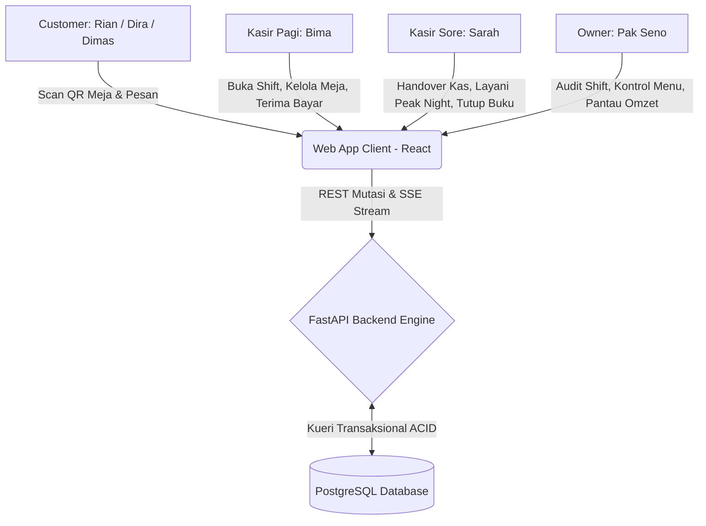
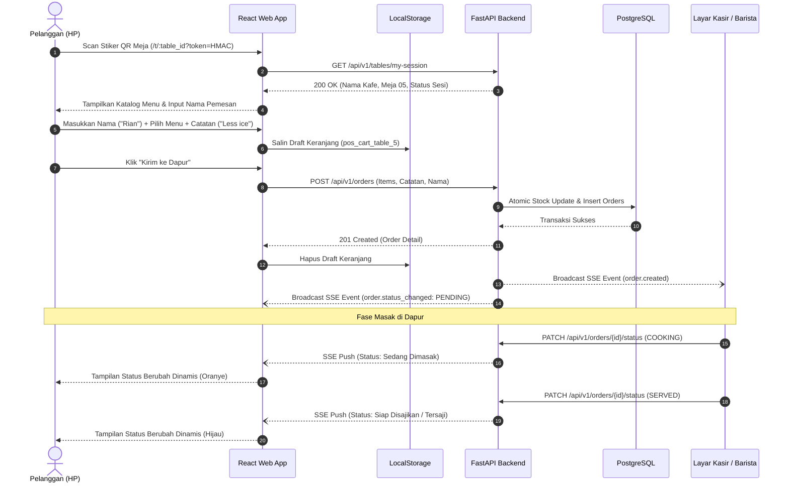
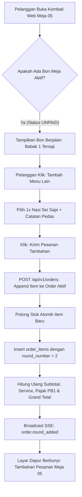
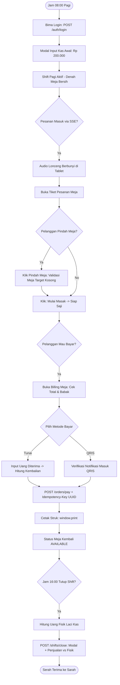
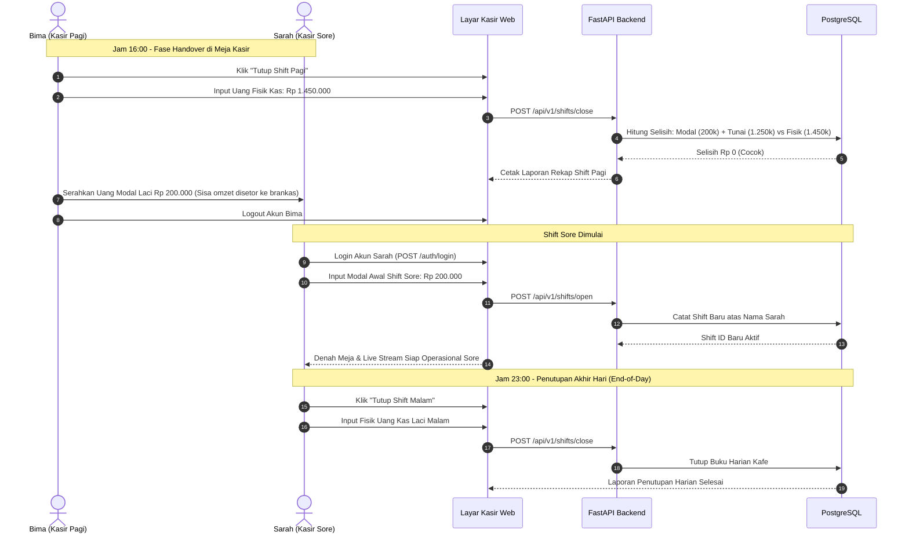
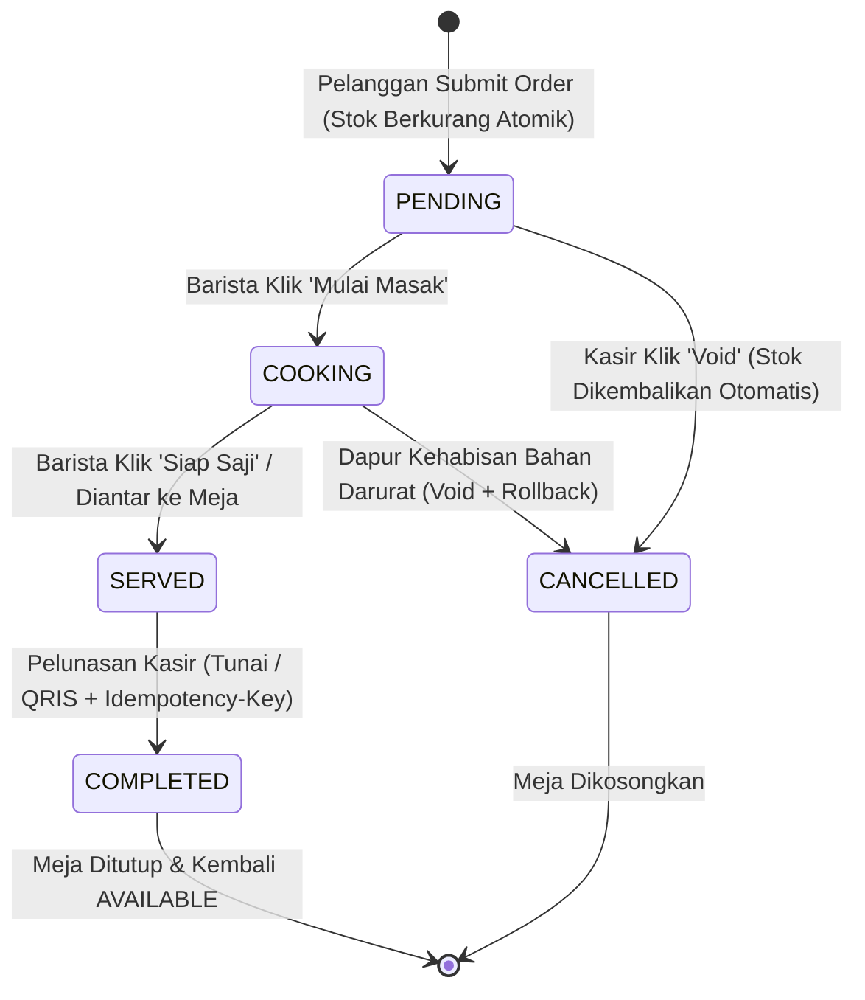

# App Flow Documentation (AFD)

Dokumen ini mendefinisikan alur interaksi pengguna, transisi status, komunikasi antar-komponen, penanganan kasus tepi (*edge cases*), dan pemulihan error untuk Kafe Dine-in Web POS. Dokumen ini merupakan turunan langsung dari `docs/01-PRD.md` dan `docs/02-TRD.md`.

Visualisasi interaktif resmi tersedia di `.archify/workflow-app-flow-20261106-092506/app-flow-sequence.html`.

---

## 1. Peta Peran & Tanggung Jawab Alur

Sistem melayani empat aktor utama dengan alur kerja yang terkoordinasi:

---

## 2. Alur Pengguna Langkah Demi Langkah (Step-by-Step User Journeys)

### 2.1 Alur Pelanggan (Customer Journey)
*Mencakup Persona 1A (Rian - WFC Solo), Persona 1B (Dira - Geng Hangout), dan Persona 1C (Mas Dimas - Makan Siang Kilat).*

1. **Akses Meja Tanpa Hambatan (FR-01):**
   * Pelanggan membuka kamera ponsel pintar dan memindai QR code di meja.
   * Peramban membuka tautan `https://kafe.app/t/{table_id}?token={signed_token}`.
   * Frontend memverifikasi sesi ke endpoint `GET /api/v1/tables/my-session`.
   * Jika sah, halaman menampilkan nama kafe, badge Meja 05, dan katalog menu lengkap.
2. **Penyusunan Pesanan & Catatan Selera (FR-02, FR-03, FR-04):**
   * Pelanggan memasukkan nama panggilan (*"Rian"* atau perwakilan rombongan *"Dira"*).
   * Pelanggan memilih menu dan dapat mengetik preferensi rasa (contoh: *"Kopi susu gulanya sedikit, es dipisah"*).
   * Setiap penambahan menu otomatis tersimpan di `localStorage` peramban ponsel pelanggan (FR-05).
3. **Pemesanan Mandiri & Potong Stok Atomik (FR-06, NFR-01):**
   * Pelanggan menekan tombol "Kirim ke Dapur".
   * Sistem backend mengeksekusi kueri *Conditional Atomic Update* (`WHERE stock >= qty`).
   * Jika stok mencukupi, order tersimpan dengan status `PENDING`, dan event SSE seketika dibroadcast ke layar kasir/dapur.
4. **Pelacakan Status Realtime (FR-08):**
   * Layar ponsel pelanggan menampilkan pelacak status pesanan yang berkedip sesuai kemajuan dapur (*Menunggu Konfirmasi -> Sedang Dimasak -> Tersaji di Meja*).

---

### 2.2 Alur Pemesanan Tambahan (Multi-Round Ordering)
*Memenuhi kebutuhan Persona 1A (Rian menambah kopi kedua saat WFC) dan Persona 1B (teman Dira memesan susulan).*

* **Aturan Bisnis Multi-Round:**
  * Bon meja tetap berstatus tunggal (`active_order`).
  * Item baru dicatat di tabel `order_items` dengan penanda babak `round_number: 2`.
  * Total tagihan bon meja otomatis terakumulasi (Subtotal Babak 1 + Babak 2 + Pajak PB1 10% + Service Charge).
  * Barista dapur langsung melihat tiket tambahan baru tanpa kebingungan bon terpisah.

---

### 2.3 Alur Kasir Shift Pagi (Persona 2A: Bima)
*Mencakup pembukaan operasional kafe, penanganan pesanan, pemindahan meja, dan tutup shift siang.*

---

### 2.4 Alur Serah Terima Shift & Kasir Sore (Persona 2B: Sarah)
*Mencakup penerimaan laci kas, isolasi tanggung jawab keuangan, dan penutupan akhir hari.*

---

### 2.5 Alur Pemilik Kafe (Persona 3: Pak Seno)
*Mencakup pengawasan omzet, kendali stok darurat, dan audit pembukuan.*

1. **Pemantauan Omzet Realtime:**
   * Pak Seno membuka peramban laptop/ponsel di rute `/admin`.
   * Dashboard menampilkan kartu metrik: total omzet harian, jumlah bon meja selesai, nilai rata-rata transaksi, dan menu terlaris hari ini.
2. **Saklar Darurat Menu Habis (Sold Out Switch):**
   * Barista mengabarkan bahwa persediaan susu segar habis.
   * Pak Seno (atau kasir) membuka tabel inventaris menu dan mengklik tombol *"Tandai Habis"*.
   * Kolom `products.is_available` seketika bernilai `false`.
   * Pada detik yang sama, seluruh layar ponsel pelanggan yang membuka menu melihat menu tersebut berubah warna abu-abu dengan label *"Habis"*, mencegah order fiktif.
3. **Audit Rekonsiliasi Kasir & Ekspor CSV:**
   * Pak Seno membuka tab riwayat shift untuk memverifikasi apakah ada selisih kas antara shift Bima dan shift Sarah.
   * Mengklik tombol *"Unduh CSV"* untuk mengekspor rekap transaksi penjualan lengkap ke Microsoft Excel untuk pembukuan bulanan.

---

## 3. Penanganan Kasus Tepi & Pemulihan Error (Edge Cases & Error Flows)

### 3.1 Skenario 1: Perebutan Stok Terakhir (Sold-Out Race Condition)
* **Kasus:** Sisa porsi Croissant di sistem adalah 1. Meja 02 dan Meja 05 menekan tombol "Kirim Pesanan" secara bersamaan (selisih 100 milidetik).
* **Alur Penanganan Backend:**
  1. Kueri Meja 02 tiba lebih dulu di PostgreSQL: `UPDATE products SET stock = stock - 1 WHERE id = 'croissant' AND stock >= 1`.
  2. Kueri Meja 02 sukses (`rows_affected = 1`). Transaksi Meja 02 committed (`201 Created`). Sisa stok menjadi 0.
  3. Kueri Meja 05 tiba 100 milidetik kemudian: `UPDATE products SET stock = stock - 1 WHERE id = 'croissant' AND stock >= 1`.
  4. Karena stok sudah 0, kondisi `stock >= 1` tidak terpenuhi (`rows_affected = 0`).
  5. Backend mendeteksi 0 baris, seketika membatalkan transaksi (*ROLLBACK*), dan mengembalikan status HTTP `409 Conflict`.
  6. **Respon Frontend Pelanggan Meja 05:** Memunculkan toast dialog merah: *"Mohon maaf, stok Butter Croissant baru saja habis dipesan meja lain."*. Keranjang belanja pelanggan **tidak dihapus**, pelanggan hanya diminta menghapus item yang habis tersebut lalu mengirim ulang.

---

### 3.2 Skenario 2: WiFi Kafe Terputus di Tengah Transaksi (Network Jitter & Reconnect)
* **Kasus:** Jaringan internet WiFi kafe mati mendadak selama 15 detik saat jam sibuk.
* **Alur Penanganan:**
  1. Jalur SSE terputus. Indikator jaringan di pojok kanan atas layar kasir otomatis berubah dari Hijau (*SSE Aktif*) menjadi Kuning (*Menyambung Ulang...*).
  2. Tombol bayar kasir dinonaktifkan sementara untuk mencegah transaksi menggantung.
  3. Peramban kasir menjalankan mekanisme *auto-reconnect* bawaan `EventSource` di latar belakang.
  4. Saat internet menyala kembali, koneksi SSE otomatis terhubung ulang, indikator kembali Hijau, dan frontend secara otomatis memanggil endpoint rekonsiliasi ringan `GET /api/v1/orders/active` untuk menarik pesanan yang sempat terlewat saat jaringan mati.

---

### 3.3 Skenario 3: Kasir Double Click Tombol Bayar (Idempotency Collision)
* **Kasus:** Kasir menekan tombol "Selesaikan Bayar" sebanyak 3 kali berturut-turut dalam 500 milidetik karena mengira sistem sedang macet.
* **Alur Penanganan:**
  1. Frontend kasir menyertakan header `Idempotency-Key: {UUID}` yang sama pada ketiga request tersebut.
  2. Request pertama memproses pembayaran, mengunci bon, mencatat baris di tabel `payments`, dan mengembalikan `200 OK`.
  3. Request kedua dan ketiga tiba di PostgreSQL. Database mendeteksi pelanggaran *unique constraint* pada kolom `idempotency_key`.
  4. Backend menangkap pelanggaran tersebut, tidak memproses pemotongan kas kedua, melainkan langsung mengambil data pembayaran pertama dan mengembalikannya ke kasir dengan status `200 OK`. Kas masuk tidak pernah tercatat ganda.

---

### 3.4 Skenario 4: Pembatalan Pesanan Salah Input (Void Order & Rollback Stok)
* **Kasus:** Tamu Meja 03 salah menekan jumlah (memesan 5 Kopi Susu padahal hanya ingin 1), lalu segera melapor ke kasir sebelum minuman dibuat.
* **Alur Penanganan:**
  1. Kasir membuka bon Meja 03, menekan tombol *"Batalkan (Void)"*, dan memasukkan alasan pembatalan: *"Salah input kuantitas pelanggan"*.
  2. Backend membuka transaksi:
     * Mengubah status pesanan menjadi `CANCELLED`.
     * Menjalankan kueri pengembalian stok: `UPDATE products SET stock = stock + 5 WHERE id = :product_id`.
  3. Transaksi di-commit. Stok di database bertambah kembali 5 cup secara utuh.
  4. Event SSE dikirimkan untuk memperbarui tampilan meja kasir dan layar ponsel pelanggan.

---

## 4. Diagram Status Siklus Hidup Pesanan (Order State Lifecycle)

---

## 5. Ringkasan Status HTTP & Kode Error Bisnis

| Kondisi Bisnis | Kode HTTP | Kode Error Internal | Tindakan Frontend |
| :--- | :--- | :--- | :--- |
| **Pesanan Berhasil Masuk** | `201 Created` | `-` | Bersihkan localStorage keranjang, alihkan ke live status. |
| **Stok Barang Tidak Cukup** | `409 Conflict` | `INSUFFICIENT_STOCK` | Tampilkan toast merah, pertahankan isi keranjang. |
| **Menu Dinonaktifkan (Habis)** | `409 Conflict` | `PRODUCT_UNAVAILABLE` | Minta pelanggan menghapus item yang sold out. |
| **Kuantitas Negatif / Nol** | `422 Unprocessable` | `INVALID_QUANTITY` | Validasi gagal, tolak sebelum masuk transaksi DB. |
| **Token Meja Tidak Sah / Palsu** | `401 Unauthorized` | `INVALID_TABLE_TOKEN` | Tampilkan layar peringatan: "Silakan pindai ulang QR meja resmi". |
| **Kasir Akses Rute Admin** | `403 Forbidden` | `INSUFFICIENT_PRIVILEGE`| Tolak aksi, tampilkan pesan: "Akses khusus pemilik kafe". |
| **Akses Data Kafe Lain (BOLA)** | `404 Not Found` | `ORDER_NOT_FOUND` | Samarkan data tenant lain, lindungi kerahasiaan. |
| **Serangan Brute-Force Login** | `429 Too Many Req` | `RATE_LIMIT_EXCEEDED` | Kunci form login selama 60 detik. |
| **Pembayaran Bon yang Sudah Tutup**| `400 Bad Request`| `ORDER_ALREADY_CLOSED` | Informasikan kasir bahwa bon ini sudah lunas sebelumnya. |
