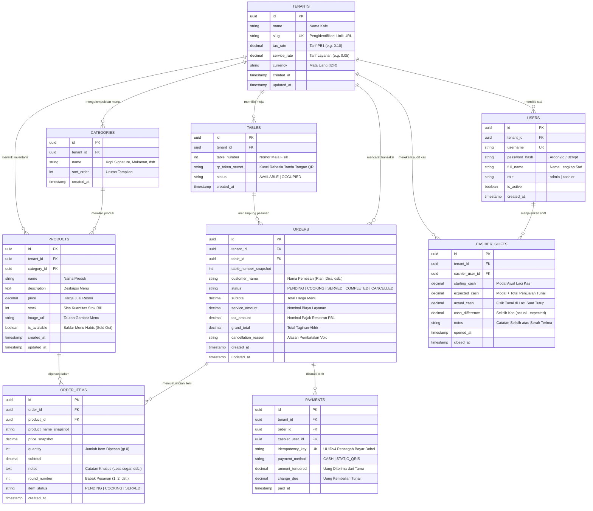

# Backend Schema Documentation (BSD)

Dokumen ini mendefinisikan rancangan teknis lengkap lapisan data dan antarmuka pemrograman aplikasi (API) untuk Kafe Dine-in Web POS. Dokumen ini merupakan turunan langsung dari `docs/01-PRD.md`, `docs/02-TRD.md`, `docs/03-AFD.md`, serta `docs/04-DBD.md`.

Visualisasi arsitektur skema database PostgreSQL resmi tersedia di `.archify/architecture-database-schema-20261106-080442/database-schema.html`.

---

## 1. Pendahuluan & Prinsip Desain Data

### 1.1 Standar Rekayasa Basis Data
1. **Integritas Relasional Penuh:** Menggunakan PostgreSQL 15+ dengan penegakan kunci primer (*Primary Key* UUIDv4), kunci asing (*Foreign Key*), batasan keunikan (*Unique Constraints*), dan indeks performa tinggi.
2. **Isolasi Multi-Tenant Wajib:** Seluruh tabel yang menyimpan data spesifik kafe memiliki kolom `tenant_id: UUID NOT NULL REFERENCES tenants(id) ON DELETE CASCADE`. Setiap kueri wajib menyertakan filter `WHERE tenant_id = :tenant_id` dari JWT staf atau token sesi meja sah.
3. **Snapshot Finansial Kebal Inflasi:** Tabel transaksi (`orders`, `order_items`, `payments`) menyimpan snapshot nama produk (`product_name_snapshot`), nomor meja (`table_number_snapshot`), dan harga satuan (`price_snapshot`) saat transaksi terjadi. Perubahan nama atau kenaikan harga menu di masa depan tidak akan mengubah riwayat pembukuan masa lalu.
4. **Idempotensi Pembayaran:** Tabel `payments` memiliki kolom `idempotency_key: VARCHAR(64) UNIQUE NOT NULL` untuk menjamin mutasi kas tidak tercatat ganda saat koneksi jaringan tidak stabil.

---

## 2. Diagram Relasi Entitas (Entity-Relationship Diagram)



---

## 3. Definisi Skema PostgreSQL Lengkap (DDL)

```sql
-- Aktifkan ekstensi UUID generator
CREATE EXTENSION IF NOT EXISTS "uuid-ossp";

-- 1. TABEL TENANTS (Akar Multi-Tenancy)
CREATE TABLE tenants (
    id UUID PRIMARY KEY DEFAULT uuid_generate_v4(),
    name VARCHAR(100) NOT NULL,
    slug VARCHAR(50) UNIQUE NOT NULL,
    tax_rate NUMERIC(4, 4) NOT NULL DEFAULT 0.1000,     -- Default PB1 10%
    service_rate NUMERIC(4, 4) NOT NULL DEFAULT 0.0500, -- Default Layanan 5%
    currency VARCHAR(5) NOT NULL DEFAULT 'IDR',
    created_at TIMESTAMPTZ NOT NULL DEFAULT CURRENT_TIMESTAMP,
    updated_at TIMESTAMPTZ NOT NULL DEFAULT CURRENT_TIMESTAMP
);

CREATE INDEX idx_tenants_slug ON tenants(slug);

-- 2. TABEL USERS (Staf Kasir & Admin)
CREATE TABLE users (
    id UUID PRIMARY KEY DEFAULT uuid_generate_v4(),
    tenant_id UUID NOT NULL REFERENCES tenants(id) ON DELETE CASCADE,
    username VARCHAR(50) NOT NULL,
    password_hash VARCHAR(255) NOT NULL,
    full_name VARCHAR(100) NOT NULL,
    role VARCHAR(20) NOT NULL CHECK (role IN ('admin', 'cashier')),
    is_active BOOLEAN NOT NULL DEFAULT true,
    created_at TIMESTAMPTZ NOT NULL DEFAULT CURRENT_TIMESTAMP,
    CONSTRAINT uq_tenant_username UNIQUE (tenant_id, username)
);

CREATE INDEX idx_users_tenant_role ON users(tenant_id, role);

-- 3. TABEL TABLES (Denah Meja Restoran)
CREATE TABLE tables (
    id UUID PRIMARY KEY DEFAULT uuid_generate_v4(),
    tenant_id UUID NOT NULL REFERENCES tenants(id) ON DELETE CASCADE,
    table_number INT NOT NULL,
    qr_token_secret VARCHAR(64) NOT NULL,
    status VARCHAR(20) NOT NULL DEFAULT 'AVAILABLE' CHECK (status IN ('AVAILABLE', 'OCCUPIED')),
    created_at TIMESTAMPTZ NOT NULL DEFAULT CURRENT_TIMESTAMP,
    CONSTRAINT uq_tenant_table_number UNIQUE (tenant_id, table_number)
);

CREATE INDEX idx_tables_tenant_status ON tables(tenant_id, status);

-- 4. TABEL CATEGORIES (Kategori Menu)
CREATE TABLE categories (
    id UUID PRIMARY KEY DEFAULT uuid_generate_v4(),
    tenant_id UUID NOT NULL REFERENCES tenants(id) ON DELETE CASCADE,
    name VARCHAR(50) NOT NULL,
    sort_order INT NOT NULL DEFAULT 0,
    created_at TIMESTAMPTZ NOT NULL DEFAULT CURRENT_TIMESTAMP
);

CREATE INDEX idx_categories_tenant ON categories(tenant_id, sort_order);

-- 5. TABEL PRODUCTS (Katalog Menu & Stok Riil)
CREATE TABLE products (
    id UUID PRIMARY KEY DEFAULT uuid_generate_v4(),
    tenant_id UUID NOT NULL REFERENCES tenants(id) ON DELETE CASCADE,
    category_id UUID NOT NULL REFERENCES categories(id) ON DELETE RESTRICT,
    name VARCHAR(100) NOT NULL,
    description TEXT,
    price NUMERIC(12, 2) NOT NULL CHECK (price >= 0),
    stock INT NOT NULL DEFAULT 0 CHECK (stock >= 0),
    image_url TEXT,
    is_available BOOLEAN NOT NULL DEFAULT true,
    created_at TIMESTAMPTZ NOT NULL DEFAULT CURRENT_TIMESTAMP,
    updated_at TIMESTAMPTZ NOT NULL DEFAULT CURRENT_TIMESTAMP
);

CREATE INDEX idx_products_tenant_cat ON products(tenant_id, category_id);
CREATE INDEX idx_products_tenant_avail ON products(tenant_id, is_available);

-- 6. TABEL ORDERS (Bon Transaksi Meja)
CREATE TABLE orders (
    id UUID PRIMARY KEY DEFAULT uuid_generate_v4(),
    tenant_id UUID NOT NULL REFERENCES tenants(id) ON DELETE CASCADE,
    table_id UUID NOT NULL REFERENCES tables(id) ON DELETE RESTRICT,
    table_number_snapshot INT NOT NULL,
    customer_name VARCHAR(100) NOT NULL,
    status VARCHAR(20) NOT NULL DEFAULT 'PENDING' 
        CHECK (status IN ('PENDING', 'COOKING', 'SERVED', 'COMPLETED', 'CANCELLED')),
    subtotal NUMERIC(12, 2) NOT NULL DEFAULT 0 CHECK (subtotal >= 0),
    service_amount NUMERIC(12, 2) NOT NULL DEFAULT 0 CHECK (service_amount >= 0),
    tax_amount NUMERIC(12, 2) NOT NULL DEFAULT 0 CHECK (tax_amount >= 0),
    grand_total NUMERIC(12, 2) NOT NULL DEFAULT 0 CHECK (grand_total >= 0),
    cancellation_reason TEXT,
    created_at TIMESTAMPTZ NOT NULL DEFAULT CURRENT_TIMESTAMP,
    updated_at TIMESTAMPTZ NOT NULL DEFAULT CURRENT_TIMESTAMP
);

CREATE INDEX idx_orders_tenant_status ON orders(tenant_id, status);
CREATE INDEX idx_orders_table_active ON orders(table_id, status) WHERE status NOT IN ('COMPLETED', 'CANCELLED');

-- 7. TABEL ORDER_ITEMS (Baris Menu Pesanan Bertingkat)
CREATE TABLE order_items (
    id UUID PRIMARY KEY DEFAULT uuid_generate_v4(),
    order_id UUID NOT NULL REFERENCES orders(id) ON DELETE CASCADE,
    product_id UUID NOT NULL REFERENCES products(id) ON DELETE RESTRICT,
    product_name_snapshot VARCHAR(100) NOT NULL,
    price_snapshot NUMERIC(12, 2) NOT NULL CHECK (price_snapshot >= 0),
    quantity INT NOT NULL CHECK (quantity > 0),
    subtotal NUMERIC(12, 2) NOT NULL CHECK (subtotal >= 0),
    notes TEXT,
    round_number INT NOT NULL DEFAULT 1 CHECK (round_number >= 1),
    item_status VARCHAR(20) NOT NULL DEFAULT 'PENDING' 
        CHECK (item_status IN ('PENDING', 'COOKING', 'SERVED')),
    created_at TIMESTAMPTZ NOT NULL DEFAULT CURRENT_TIMESTAMP
);

CREATE INDEX idx_order_items_order_round ON order_items(order_id, round_number);

-- 8. TABEL PAYMENTS (Pelunasan Pembayaran Idempotent)
CREATE TABLE payments (
    id UUID PRIMARY KEY DEFAULT uuid_generate_v4(),
    tenant_id UUID NOT NULL REFERENCES tenants(id) ON DELETE CASCADE,
    order_id UUID NOT NULL REFERENCES orders(id) ON DELETE RESTRICT,
    cashier_user_id UUID NOT NULL REFERENCES users(id) ON DELETE RESTRICT,
    idempotency_key VARCHAR(64) UNIQUE NOT NULL,
    payment_method VARCHAR(20) NOT NULL CHECK (payment_method IN ('CASH', 'STATIC_QRIS')),
    amount_tendered NUMERIC(12, 2) NOT NULL CHECK (amount_tendered >= 0),
    change_due NUMERIC(12, 2) NOT NULL DEFAULT 0 CHECK (change_due >= 0),
    paid_at TIMESTAMPTZ NOT NULL DEFAULT CURRENT_TIMESTAMP
);

CREATE INDEX idx_payments_tenant_order ON payments(tenant_id, order_id);
CREATE INDEX idx_payments_idempotency ON payments(idempotency_key);

-- 9. TABEL CASHIER_SHIFTS (Audit Shift & Rekonsiliasi Kas)
CREATE TABLE cashier_shifts (
    id UUID PRIMARY KEY DEFAULT uuid_generate_v4(),
    tenant_id UUID NOT NULL REFERENCES tenants(id) ON DELETE CASCADE,
    cashier_user_id UUID NOT NULL REFERENCES users(id) ON DELETE RESTRICT,
    starting_cash NUMERIC(12, 2) NOT NULL CHECK (starting_cash >= 0),
    expected_cash NUMERIC(12, 2) CHECK (expected_cash >= 0),
    actual_cash NUMERIC(12, 2) CHECK (actual_cash >= 0),
    cash_difference NUMERIC(12, 2),
    notes TEXT,
    opened_at TIMESTAMPTZ NOT NULL DEFAULT CURRENT_TIMESTAMP,
    closed_at TIMESTAMPTZ
);

CREATE INDEX idx_shifts_tenant_cashier ON cashier_shifts(tenant_id, cashier_user_id);
CREATE INDEX idx_shifts_active ON cashier_shifts(tenant_id, closed_at) WHERE closed_at IS NULL;
```

---

## 4. Logika Transaksi Atomik & Kueri Kritis

### 4.1 Pemesanan & Pengurangan Stok Atomik (Conditional Atomic Update)
Saat pelanggan menekan tombol checkout (`POST /api/v1/orders`), backend mengeksekusi operasi berikut dalam satu transaksi database tunggal:

```python
async with async_session.begin():
    # 1. Hitung subtotal dan kunci/potong stok tiap item secara atomik
    for item in order_payload.items:
        stmt = (
            update(Product)
            .where(
                Product.id == item.product_id,
                Product.tenant_id == tenant_id,
                Product.is_available == True,
                Product.stock >= item.quantity
            )
            .values(stock=Product.stock - item.quantity)
            .returning(Product.id, Product.name, Product.price)
        )
        result = await session.execute(stmt)
        updated_row = result.fetchone()
        
        # Jika baris terpengaruh == 0, stok kurang atau menu baru saja dinonaktifkan
        if not updated_row:
            await session.rollback()
            raise InsufficientStockException(product_id=item.product_id)
            
    # 2. Ambil atau buat record Order aktif meja
    # 3. Insert record OrderItem dengan snapshot nama dan harga resmi DB
    # 4. Hitung service_amount = subtotal * tenant.service_rate
    # 5. Hitung tax_amount = (subtotal + service_amount) * tenant.tax_rate
    # 6. Hitung grand_total = subtotal + service_amount + tax_amount
    # 7. COMMIT otomatis saat keluar blok begin()
```

---

### 4.2 Pembatalan Pesanan (Void Order & Rollback Stok)
Saat kasir membatalkan pesanan (`POST /api/v1/orders/{id}/cancel`):

```sql
BEGIN;

-- 1. Pastikan pesanan belum selesai/lunas
UPDATE orders 
SET status = 'CANCELLED', cancellation_reason = :reason, updated_at = CURRENT_TIMESTAMP
WHERE id = :order_id AND tenant_id = :tenant_id AND status IN ('PENDING', 'COOKING');

-- 2. Kembalikan kuantitas stok seluruh produk di pesanan tersebut
UPDATE products p
SET stock = p.stock + oi.quantity
FROM order_items oi
WHERE oi.order_id = :order_id AND p.id = oi.product_id;

-- 3. Kosongkan status meja kembali AVAILABLE
UPDATE tables 
SET status = 'AVAILABLE' 
WHERE id = (SELECT table_id FROM orders WHERE id = :order_id);

COMMIT;
```

---

## 5. Kontrak API REST v1 Komprehensif

Seluruh request mutasi data menggunakan header `Content-Type: application/json`. Seluruh rute terproteksi mewajibkan header `Authorization: Bearer <token>` atau query parameter token sesi meja yang sah.

### 5.1 Endpoint Autentikasi Staf (`/api/v1/auth`)

#### `POST /api/v1/auth/login`
* **Deskripsi:** Autentikasi login kasir atau admin.
* **Request Body:**
  ```json
  {
    "tenant_slug": "kafe-senja",
    "username": "bima",
    "password": "PasswordKuat123"
  }
  ```
* **Response `200 OK`:**
  ```json
  {
    "success": true,
    "data": {
      "access_token": "eyJhbGciOi...",
      "token_type": "bearer",
      "expires_in": 43200,
      "user": {
        "id": "u1a2b3c4-...",
        "username": "bima",
        "full_name": "Bima Adji",
        "role": "cashier",
        "tenant_id": "t1a2b3c4-..."
      }
    }
  }
  ```
* **Error Response `401 Unauthorized`:**
  ```json
  {
    "success": false,
    "error": {
      "code": "INVALID_CREDENTIALS",
      "message": "Nama pengguna atau kata sandi tidak valid."
    }
  }
  ```

---

### 5.2 Endpoint Menu & Meja Pelanggan (`/api/v1/menu`, `/api/v1/tables`)

#### `GET /api/v1/menu`
* **Deskripsi:** Mengambil katalog menu aktif yang dikelompokkan per kategori.
* **Header / Auth:** Wajib menyertakan token meja atau JWT staf.
* **Response `200 OK`:**
  ```json
  {
    "success": true,
    "data": [
      {
        "category_id": "c1a2b3c4-...",
        "category_name": "Kopi Signature",
        "items": [
          {
            "id": "p1a2b3c4-...",
            "name": "Kopi Aren Senja",
            "description": "Espresso ganda, susu segar pasteurisasi, aren alami.",
            "price": 22000.00,
            "stock": 45,
            "is_available": true,
            "image_url": "https://..."
          }
        ]
      }
    ]
  }
  ```

#### `GET /api/v1/tables/my-session`
* **Deskripsi:** Mengambil status sesi meja aktif untuk verifikasi token QR pelanggan.
* **Auth:** Token Meja (`/t/:table_id?token=...`).
* **Response `200 OK`:**
  ```json
  {
    "success": true,
    "data": {
      "tenant_name": "Kafe Senja Kopi",
      "table_id": "tbl_05_uuid",
      "table_number": 5,
      "has_active_order": true,
      "active_order": {
        "order_id": "ord_102_uuid",
        "status": "COOKING",
        "customer_name": "Rian",
        "subtotal": 72000.00,
        "service_amount": 3600.00,
        "tax_amount": 7560.00,
        "grand_total": 83160.00,
        "items": [
          {
            "product_name": "Kopi Aren Senja",
            "quantity": 2,
            "price": 22000.00,
            "subtotal": 44000.00,
            "notes": "Less ice",
            "round_number": 1,
            "item_status": "COOKING"
          }
        ]
      }
    }
  }
  ```

---

### 5.3 Endpoint Pemesanan & Pembayaran (`/api/v1/orders`)

#### `POST /api/v1/orders`
* **Deskripsi:** Membuat pesanan baru atau menambah pesanan babak berikutnya (*multi-round*).
* **Request Body:**
  ```json
  {
    "table_token": "eyJhbGciOi...",
    "customer_name": "Rian",
    "items": [
      {
        "product_id": "p1a2b3c4-...",
        "quantity": 2,
        "notes": "Less ice, gula aren 50%"
      },
      {
        "product_id": "p2a2b3c4-...",
        "quantity": 1,
        "notes": null
      }
    ]
  }
  ```
* **Response `201 Created`:**
  ```json
  {
    "success": true,
    "data": {
      "order_id": "ord_102_uuid",
      "table_number": 5,
      "customer_name": "Rian",
      "status": "PENDING",
      "round_number": 1,
      "subtotal": 72000.00,
      "service_amount": 3600.00,
      "tax_amount": 7560.00,
      "grand_total": 83160.00,
      "created_at": "2026-11-06T14:32:00Z"
    }
  }
  ```
* **Error Response `409 Conflict` (Stok Kurang):**
  ```json
  {
    "success": false,
    "error": {
      "code": "INSUFFICIENT_STOCK",
      "message": "Stok produk Kopi Aren Senja tidak mencukupi (sisa 1).",
      "details": {
        "product_id": "p1a2b3c4-...",
        "available_stock": 1,
        "requested_qty": 2
      }
    }
  }
  ```

#### `POST /api/v1/orders/{id}/pay`
* **Deskripsi:** Melunasi tagihan meja kasir (Wajib menyertakan `Idempotency-Key`).
* **Headers:**
  * `Authorization: Bearer <kasir_jwt>`
  * `Idempotency-Key: e82f1b8a-9c42-4f31-8723-1189ac3f0901`
* **Request Body:**
  ```json
  {
    "payment_method": "CASH",
    "amount_tendered": 100000.00
  }
  ```
* **Response `200 OK`:**
  ```json
  {
    "success": true,
    "data": {
      "payment_id": "pay_987_uuid",
      "order_id": "ord_102_uuid",
      "status": "COMPLETED",
      "grand_total": 83160.00,
      "amount_tendered": 100000.00,
      "change_due": 16840.00,
      "payment_method": "CASH",
      "paid_at": "2026-11-06T15:10:00Z"
    }
  }
  ```

#### `PATCH /api/v1/orders/{id}/move-table`
* **Deskripsi:** Memindahkan pesanan meja aktif ke meja kosong lain.
* **Request Body:**
  ```json
  {
    "new_table_number": 8
  }
  ```
* **Response `200 OK`:**
  ```json
  {
    "success": true,
    "data": {
      "order_id": "ord_102_uuid",
      "old_table_number": 5,
      "new_table_number": 8,
      "message": "Pesanan berhasil dipindahkan ke Meja 08."
    }
  }
  ```

---

### 5.4 Endpoint Shift Kasir (`/api/v1/shifts`)

#### `POST /api/v1/shifts/open`
* **Request Body:**
  ```json
  {
    "starting_cash": 200000.00
  }
  ```
* **Response `201 Created`:**
  ```json
  {
    "success": true,
    "data": {
      "shift_id": "shf_123_uuid",
      "cashier_name": "Bima Adji",
      "starting_cash": 200000.00,
      "opened_at": "2026-11-06T08:00:00Z"
    }
  }
  ```

#### `POST /api/v1/shifts/close`
* **Request Body:**
  ```json
  {
    "actual_cash": 1450000.00,
    "notes": "Serah terima shift pagi ke Sarah lancar."
  }
  ```
* **Response `200 OK`:**
  ```json
  {
    "success": true,
    "data": {
      "shift_id": "shf_123_uuid",
      "starting_cash": 200000.00,
      "cash_sales_total": 1250000.00,
      "expected_cash": 1450000.00,
      "actual_cash": 1450000.00,
      "cash_difference": 0.00,
      "closed_at": "2026-11-06T16:00:00Z"
    }
  }
  ```

---

## 6. Spesifikasi Kontrak Event Realtime (Server-Sent Events)

* **Jalur Koneksi:** `GET /api/v1/orders/stream`
* **Headers Respons:**
  * `Content-Type: text/event-stream`
  * `Cache-Control: no-cache`
  * `Connection: keep-alive`
  * `X-Accel-Buffering: no` (Mencegah buffer proxy Nginx/Render)

### Daftar Event Resmi

1. **`event: order.created`**
   * *Target:* Kasir & Barista Dapur.
   * *Payload:*
     ```json
     {
       "order_id": "ord_102_uuid",
       "table_number": 5,
       "customer_name": "Rian",
       "round_number": 1,
       "items": [
         { "name": "Kopi Aren Senja", "qty": 2, "notes": "Less ice" },
         { "name": "Butter Croissant", "qty": 1, "notes": null }
       ],
       "total_amount": 79200.00,
       "timestamp": "2026-11-06T14:32:00Z"
     }
     ```

2. **`event: order.round_added`**
   * *Target:* Kasir & Dapur.
   * *Payload:* Pesanan babak tambahan (`round_number: 2`) untuk meja yang sama beserta akumulasi total tagihan terbaru.

3. **`event: order.status_changed`**
   * *Target:* Pelanggan Meja & Kasir.
   * *Payload:*
     ```json
     {
       "order_id": "ord_102_uuid",
       "table_number": 5,
       "old_status": "PENDING",
       "new_status": "COOKING",
       "updated_at": "2026-11-06T14:34:00Z"
     }
     ```

4. **`event: order.completed`**
   * *Target:* Pelanggan Meja (Menampilkan E-Receipt Lunas) & Kasir (Status Meja kembali Available).

5. **`event: ping`**
   * *Target:* Semua koneksi aktif setiap 20 detik untuk menjaga jalur socket tetap terbuka.

---

## 7. Strategi Migrasi Basis Data (Alembic)

Pengelolaan versi basis data diotomatisasi menggunakan **Alembic**:
* **Konfigurasi Lingkungan (`alembic/env.py`):** Menggunakan driver asynchronous `asyncpg` (`postgresql+asyncpg://...`).
* **Penamaan Versi Migrasi:** `YYYYMMDD_HHMM_<deskripsi_singkat>.py` (contoh: `20261106_0900_create_initial_tenants_and_orders.py`).
* **Aturan Zero-Downtime:**
  * Penambahan kolom baru wajib memiliki nilai default (`DEFAULT`) atau berstatus nullable (`nullable=True`).
  * Migrasi tidak boleh memutus koneksi transaksi aktif atau mengunci tabel utama secara eksklusif dalam durasi panjang.
* **Perintah Migrasi:**
  ```bash
  # Membuat skrip migrasi baru otomatis dari model SQLAlchemy
  alembic revision --autogenerate -m "create initial schema"
  
  # Menjalankan migrasi ke versi terbaru di produksi
  alembic upgrade head
  ```
