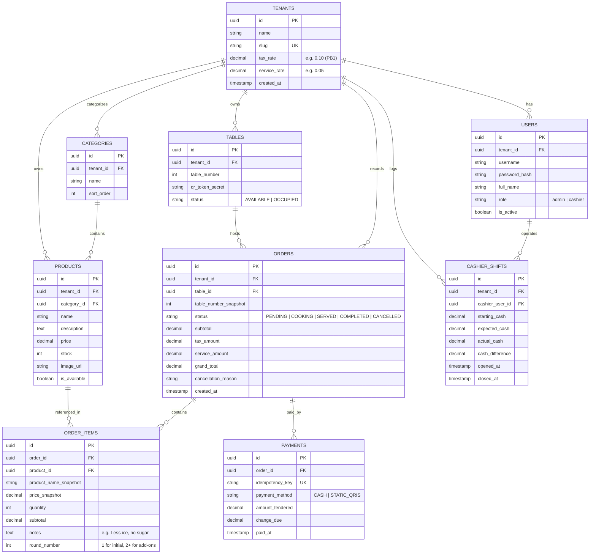

# Rebuild Architecture Plan: Kafe Dine-in Web POS

Dokumen ini merangkum seluruh keputusan arsitektur, spesifikasi teknis, skema database, alur UI/UX, dan peta jalan implementasi hasil wawancara mendalam (*grilling session*).

---

## 1. Visi Produk & Target Pengguna
* **Target Pengguna Awal:** Coffee shop dan kafe mandiri (*independent cafe*) skala 10–25 meja dengan model operasional Dine-in.
* **Problem Utama:** Antrean menumpuk di meja kasir saat jam sibuk (*peak hours*), pesanan salah catat, dan mahalnya software POS dine-in komersial yang membutuhkan perangkat khusus/biaya bulanan jutaan rupiah.
* **Pembeda Utama:**
  * **Zero Friction Customer Self-Ordering:** Pelanggan cukup scan QR di meja menggunakan kamera HP tanpa perlu menginstal aplikasi (*zero install*), membuka katalog menu visual yang cepat, dan mengirim pesanan langsung ke dapur.
  * **Unified Cashier & Kitchen Feed:** Layar kasir responsif yang memadukan denah meja (*table grid*) dan *live order stream* yang berbunyi/berkedip seketika saat ada pesanan masuk lewat koneksi Server-Sent Events (SSE).
  * **Zero Capital Hardware:** Berjalan 100% di browser modern (bisa memakai tablet/laptop/smartphone yang sudah dimiliki pemilik kafe) dan printer thermal standar browser (`window.print()`).

---

## 2. Model Distribusi & Infrastruktur (Biaya Rp 0)
* **Model Multi-Tenancy:** Single-Codebase SaaS Multi-Tenant dengan strategi **Row-Level Isolation** (kolom `tenant_id` pada setiap tabel). Setiap query data wajib memfilter `tenant_id` dari JWT token.
* **Lingkungan Produksi (Rp 0 Cost):**
  * **Backend API:** FastAPI (Python 3.11+) dikontainerisasi dengan Docker, di-deploy ke PaaS Free-Tier (Render / Fly.io / Railway).
  * **Database:** Managed Cloud PostgreSQL Free-Tier (Supabase / Neon DB).
  * **Frontend Web:** React (Vite) + Tailwind CSS + TypeScript di-deploy ke Vercel / Cloudflare Pages.
  * **Domain & SSL:** Menggunakan subdomain bawaan PaaS dengan sertifikat SSL/HTTPS otomatis (wajib untuk akses kamera & browser security).
* **Lingkungan Development Lokal:** Menggunakan `docker-compose.yml` untuk menjalankan PostgreSQL lokal dan backend FastAPI dalam satu perintah.

---

## 3. Technology Stack & Arsitektur Komunikasi
* **Backend:** Python + FastAPI (Asyncio, Pydantic v2, SQLAlchemy 2.0 Async ORM, Alembic untuk migrasi).
* **Frontend:** React 18+ (Vite) + TypeScript + Tailwind CSS (Single Page Application dengan 3 portal: `/t/:table_token` untuk Customer, `/cashier` untuk Kasir, `/admin` untuk Owner).
* **Protokol Komunikasi (Hybrid REST + SSE):**
  * **REST API:** Untuk seluruh mutasi data transaksional (`POST /orders`, `PATCH /orders/{id}/pay`, `POST /products`, dsb.) dengan status code HTTP standar (`200`, `201`, `400`, `401`, `403`, `409`, `422`).
  * **Server-Sent Events (SSE):** Endpoint `GET /api/v1/orders/stream` khusus untuk *server-to-client streaming* notifikasi realtime ke layar kasir dan live status pesanan meja customer. Dilengkapi fitur *Auto-Reconnect* bawaan browser.
* **Resilience Layer:**
  * **Optimistic UI:** Perubahan status pesanan di layar kasir berpindah seketika di frontend (0 ms) sebelum request background selesai.
  * **LocalStorage Draft:** Keranjang belanja pelanggan disimpan di `localStorage` HP agar tidak hilang jika layar HP reload/terkunci.
  * **Idempotency Key:** Header `Idempotency-Key: <UUID>` pada endpoint pembayaran kasir untuk mencegah pencatatan transaksi ganda akibat *double click* atau *network jitter*.

---

## 4. Desain Autentikasi & Sesi Meja
1. **Staf (Kasir & Admin):**
   * Password di-hash menggunakan algoritma **Argon2id** / **Bcrypt**.
   * Autentikasi berbasis **JWT Bearer Token** memuat payload: `{ "user_id": ..., "tenant_id": ..., "role": "cashier" | "admin" }`.
   * FastAPI Dependency Injection memeriksa role: jika kasir mengakses endpoint laporan keuangan/hapus produk, server merespons `403 Forbidden`.
2. **Customer (Signed Table QR Token):**
   * Pelanggan tidak perlu login dengan akun/password.
   * Stiker QR di meja memuat URL dengan token kriptografis bertanda-tangan HMAC-SHA256: `https://kafe.app/t/{table_id}?token={signed_jwt}`.
   * Backend memverifikasi token ini untuk memastikan pesanan yang masuk benar-benar berasal dari Meja yang sah dan terisolasi per tenant.

---

## 5. Skema Database PostgreSQL Lengkap



### Mekanisme Pengurangan Stok Atomik (Pessimistic Check):
Stok dikurangi saat order dibuat di dalam blok transaksi database:
```sql
UPDATE products 
SET stock = stock - :qty 
WHERE id = :product_id 
  AND tenant_id = :tenant_id 
  AND stock >= :qty;
```
Jika `rows_affected == 0`, transaksi otomatis di-`ROLLBACK` dan server mengembalikan respons `409 Conflict: Stok tidak mencukupi atau produk dinonaktifkan`. Jika pesanan dibatalkan (void), stok dikembalikan dengan kueri penambahan (`stock = stock + :qty`).

---

## 6. Arsitektur UI/UX (Implementasi Mockup V2)
File acuan interaktif: `docs/mockupv3.html` (didukung diagram arsitektur interaktif di `.archify/architecture-database-schema-20261106-080442/database-schema.html`).

1. **Layar Customer (Mobile-First Web via QR):**
   * Header Meja dengan nama kafe & status pesanan aktif.
   * Filter kategori produk berbentuk horizontal scroll pills.
   * Kartu menu visual dengan foto, deskripsi, harga, badge ketersediaan, dan tombol `[ + ]`.
   * Modal preferensi rasa / catatan per item (*"Less ice, less sugar"*).
   * Floating bottom bar keranjang dengan ringkasan subtotal dan tombol "Kirim ke Dapur".
   * E-Receipt digital saat pesanan telah dibayar.
2. **Layar Kasir / Barista (Hybrid Table Grid + Live Stream):**
   * **Denah Meja Resto (Grid):** Visual 12-25 meja dengan kode warna dinamis (*Abu = Kosong, Kuning = Sedang Makan / Belum Bayar, Biru = Pesanan Baru Masuk*).
   * **Live Stream Ticker:** Notifikasi bar di bagian atas yang berkedip dan berbunyi seketika saat ada order baru masuk via SSE.
   * **Drawer Billing Meja:** Rincian bon meja aktif dengan pemisahan riwayat pesanan bertingkat (*Multi-round: Babak 1 vs Babak 2*), perhitungan pajak PB1 10%, tombol *Pindah Meja*, tombol *Void (Batalkan)*, dan tombol *Bayar Tunai / QRIS Statis*.
   * **Toggle Mode Stream Penuh:** Kasir dapat berpindah ke tampilan tabel urutan waktu masuk (*FIFO stream*) untuk pemrosesan dapur cepat saat antrean padat.
3. **Layar Admin / Owner (Portal Pengawasan Bisnis):**
   * **4 Kartu Metrik Utama:** Total Omzet Hari Ini, Jumlah Transaksi Meja, Menu Terlaris, dan Peringatan Stok Menipis.
   * **Tabel Kontrol Stok Cepat:** Saklar satu klik untuk menandai menu *Sold Out / Habis* jika bahan di dapur habis seketika.
   * **Laporan Shift Kasir:** Rekonsiliasi modal awal laci kas vs uang tunai yang tercatat di sistem vs uang fisik saat tutup kasir.
   * **Ekspor CSV:** Tombol unduh pembukuan transaksi harian/bulanan.

---

## 7. Strategi Pengujian (Testing Suite)
Pengujian dijalankan otomatis menggunakan **Pytest**:
1. **Critical Transaction Tests:**
   * Siklus hidup pesanan: `Create Order ➔ Deduct Stock ➔ Multi-round Append ➔ Pay ➔ Close Table`.
   * Pengujian Race Condition: Simulasi pesanan bersamaan saat stok tersisa 1 porsi.
   * Pengujian Void: Pembatalan pesanan mengembalikan angka stok produk ke jumlah semula.
2. **Anomaly & Edge-Case Tests (`tests/test_anomalies.py`):**
   * *Payload Price Tampering:* Client mengirim harga manipulasi; backend tetap menggunakan harga dari database.
   * *Negative/Zero Quantity:* Pengiriman `qty <= 0` ditolak dengan `422 Unprocessable Entity`.
   * *Sold-out Race:* Pesanan ke menu yang baru saja dimatikan kasir ditolak dengan `409 Conflict`.
   * *Idempotency Collision:* Kasir klik tombol bayar berkali-kali dalam 1 detik hanya memproses satu kali mutasi kas.
   * *Closed Order Payment:* Mencegah pembayaran pada bon yang sudah selesai/dibatalkan.
3. **Security Test Suite (`tests/test_security.py`):**
   * *BOLA (Cross-Tenant):* Akun Kafe A dilarang membaca atau mengubah data Kafe B (`404 / 403`).
   * *Privilege Escalation:* Akun kasir ditolak saat mengakses rute admin (`403 Forbidden`).
   * *Brute-Force Rate Limiting:* Lebih dari 5 percobaan login gagal per menit diblokir dengan `429 Too Many Requests`.
   * *Table Token Spoofing:* Akses QR meja dengan tanda-tangan token tidak sah ditolak dengan `401 Unauthorized`.

---

## 8. Roadmap Implementasi 5 Fase

| Fase | Fokus Pekerjaan | Deliverable Konkret | Konsep Backend yang Dipelajari |
| :--- | :--- | :--- | :--- |
| **Fase 1** | **Pondasi Backend, Database & Auth Multi-tenant** | Setup FastAPI + Docker Compose PostgreSQL, migrasi Alembic (`tenants`, `users`), hashing Argon2/Bcrypt, endpoint JWT login & RBAC guard. | Async SQLAlchemy, FastAPI Dependency Injection, Pydantic v2 settings, JWT authentication. |
| **Fase 2** | **Katalog Menu, Stok & Meja (Core Data)** | CRUD Kategori, Produk, Meja. Endpoint pembuatan Signed QR Table Token untuk customer. Switch cepat "Menu Habis". | Kriptografi tanda-tangan HMAC/JWT, validasi file upload / URL media, database seeders. |
| **Fase 3** | **Mesin Transaksi, Stok Atomik & Testing Kritis** | Endpoint `POST /orders`, transaksi stok `WHERE stock >= qty`, pembatalan order (void + rollback stok), multi-round ordering, idempotency key pembayaran kasir, serta eksekusi Pytest suite (anomali & security). | Isolasi transaksi ACID, row-level locking, race condition mitigation, automated integration testing. |
| **Fase 4** | **Realtime Live Order & Frontend React Web** | Stream SSE di FastAPI (`/orders/stream`), Frontend React Vite (Web Customer QR, Web Kasir Table Grid + Stream, Web Admin). Optimistic UI, auto-reconnect SSE, dan draft keranjang LocalStorage. | Server-Sent Events, Web Streams, state management frontend, responsive mobile-first UI. |
| **Fase 5** | **Operasional Kafe, Deployment Rp 0 & Uji Pilot** | Sistem shift kasir ringkas (buka/tutup modal), cetak struk browser kasir (`window.print()`), ringkasan penjualan harian/CSV, deployment backend Docker ke Render/Fly.io + database Neon/Supabase + frontend Vercel. | CI/CD, containerization Docker multi-stage build, CORS policy produksi, zero-downtime database migration. |
